# Mini NPU Simulator

## 1. 프로젝트 소개

Mini NPU Simulator는 Python을 이용하여 인공지능 연산의 기초인 MAC(Multiply-Accumulate) 연산을 직접 구현하고, 입력 패턴이 십자가(Cross)인지 X인지 판별하는 콘솔 프로그램이다.

컴퓨터는 입력된 패턴을 2차원 숫자 배열로 처리하며, 각 필터와의 MAC 연산 결과를 비교하여 패턴을 판정한다.

본 프로젝트에서는 3×3 사용자 입력 모드와 JSON 자동 분석 모드를 구현하였다.

또한 3×3, 5×5, 13×13, 25×25 크기의 패턴을 처리하고, 패턴 크기에 따른 MAC 연산 시간과 시간 복잡도를 분석하였다.

NumPy 등의 외부 라이브러리를 사용하지 않고 Python의 반복문과 표준 라이브러리만 활용하였다.

### 프로젝트 목표

- MAC 연산의 원리 이해 및 직접 구현
- 2차원 리스트를 활용한 필터와 패턴 저장
- Cross/X 패턴 판별 기능 구현
- JSON 데이터 로드 및 스키마 검증
- 라벨 정규화를 통한 일관된 판정
- epsilon 기반 부동소수점 비교 및 동점 처리
- 입력값 검증 및 예외 처리
- 크기별 MAC 연산 시간 측정
- 실패 원인 분석 및 시간 복잡도 O(N²) 검증

---

## 2. 개발 환경

| 항목 | 내용 |
|---|---|
| 개발 도구 | Visual Studio Code |
| 운영 환경 | Ubuntu (WSL) |
| 프로그래밍 언어 | Python 3.8 이상 |
| 사용 라이브러리 | json, math, re, time, pathlib |
| 외부 라이브러리 | 사용하지 않음 |
| 프로그램 유형 | Python 콘솔 애플리케이션 |

Python 표준 라이브러리만 사용하여 별도의 패키지 설치 없이 실행할 수 있도록 구현하였다.

---

## 3. 프로젝트 파일 구조

```text
Mini_NPU_Simulator/
├── main.py
├── data.json
├── README.md
└── screenshots/
    ├── 01_프로그램_실행.png
    ├── 02_필터_입력_및_저장확인.png
    ├── 03_MAC_연산_및_판정결과.png
    ├── 04_숫자개수_오류_및_재입력.png
    ├── 05_문자입력_오류_및_재입력.png
    ├── 06_입력취소_및_메뉴복귀.png
    ├── 07_JSON_자동분석_PASS_FAIL.png_1.png
    ├── 07_JSON_자동분석_PASS_FAIL.png_2.png
    ├── 08_성능분석_평균시간.png
    └── 08_최종결과_요약.png
```

### 파일별 역할

**main.py**

프로그램의 메인 실행 파일이다.

MAC 연산, 사용자 입력 처리, JSON 분석, 라벨 정규화, 패턴 판정, 성능 측정, 결과 요약 등의 기능을 포함한다.

**data.json**

5×5, 13×13, 25×25 크기의 Cross/X 필터와 테스트 패턴을 저장한 데이터 파일이다.

**README.md**

프로젝트 실행 방법, 구현 기능, 테스트 결과, 실패 원인 분석 및 시간 복잡도를 정리한 문서이다.

**screenshots/**

프로그램 실행 과정과 기능 검증 결과를 증명하기 위한 스크린샷 10장을 저장한 폴더이다.

---

## 4. 프로그램 실행 방법

### 4.1 실행 방법

Visual Studio Code에서 프로젝트 폴더를 연다.

터미널에서 다음 명령어를 실행한다.

```bash
python3 main.py
```

정상적으로 실행되면 다음 메뉴가 출력된다.

```text
========================================
       Mini NPU Simulator
========================================

[모드 선택]
1. 사용자 입력 (3x3)
2. data.json 분석
0. 프로그램 종료

선택:
```

### 4.2 모드 선택

| 입력값 | 실행 기능 |
|---|---|
| 1 | 사용자 입력(3×3) |
| 2 | data.json 자동 분석 |
| 0 | 프로그램 종료 |
| 기타 입력 | 오류 메시지 출력 후 재입력 |

사용자는 메뉴에서 원하는 기능을 선택할 수 있다.

잘못된 번호나 문자를 입력하면 오류 메시지를 출력하고 다시 메뉴를 표시한다.

### 4.3 사용자 입력 모드

사용자가 3×3 필터 A, 필터 B, 패턴을 각각 세 줄씩 입력한다.

각 줄에는 공백으로 구분된 숫자 3개를 입력해야 한다.

**필터 A: 십자가(Cross)**

```text
0 1 0
1 1 1
0 1 0
```

**필터 B: X**

```text
1 0 1
0 1 0
1 0 1
```

**입력 패턴: X**

```text
1 0 1
0 1 0
1 0 1
```

위와 같이 입력하면 다음 결과가 출력된다.

```text
[3] MAC 연산 결과
========================================
A 점수: 1.0
B 점수: 5.0
판정 결과: B
```

B 필터의 MAC 점수가 A 필터보다 높으므로 최종 판정은 B이다.

이후 3×3 MAC 연산의 평균 실행 시간과 연산 횟수를 출력한다.

### 4.4 사용자 입력 취소

필터 또는 패턴 입력 중 `q`를 입력하면 현재 작업을 취소할 수 있다.

```text
1행: q
입력을 취소하고 메뉴로 돌아갑니다.
```

프로그램을 완전히 종료하지 않고 메인 메뉴로 돌아갈 수 있도록 구현하였다.

### 4.5 JSON 자동 분석 모드

메뉴에서 2번을 선택하면 data.json 파일을 읽고 자동으로 패턴 분석을 수행한다.

실행 순서는 다음과 같다.

1. data.json 파일 로드
2. 크기별 Cross/X 필터 확인
3. 패턴 키에서 크기 정보 추출
4. 배열 구조 및 데이터 검증
5. MAC 연산 점수 계산
6. epsilon 기반 패턴 판정
7. expected와 비교하여 PASS/FAIL 출력
8. 크기별 성능 분석
9. 전체 테스트 결과 요약

---

## 5. 주요 기능 및 구현 원리

### 5.1 MAC 연산

MAC(Multiply-Accumulate)은 입력 패턴과 필터의 같은 위치에 있는 숫자를 곱한 뒤 모든 결과를 더하는 연산이다.

예를 들어 입력 패턴과 필터가 다음과 같다고 가정한다.

```text
입력 패턴        Cross 필터

0 1 0           0 1 0
1 1 1           1 1 1
0 1 0           0 1 0
```

같은 위치의 숫자를 곱한 후 결과를 모두 더한다.

```text
0×0 + 1×1 + 0×0
+ 1×1 + 1×1 + 1×1
+ 0×0 + 1×1 + 0×0

= 5
```

따라서 MAC 점수는 5.0이다.

MAC 연산은 다음 수식으로 표현할 수 있다.

\[
MAC = \sum_{i=0}^{N-1}\sum_{j=0}^{N-1} P_{ij}F_{ij}
\]

여기서 P는 입력 패턴, F는 필터, N은 배열 크기이다.

**Python 구현 코드**

```python
def mac_operation(pattern, filter_data):
    score = 0.0

    for i in range(len(pattern)):
        for j in range(len(pattern[i])):
            score += pattern[i][j] * filter_data[i][j]

    return score
```

외부 연산 라이브러리를 사용하지 않고 이중 for문으로 각 위치의 값을 곱하고 누적하도록 구현하였다.

### 5.2 2차원 리스트

입력 패턴과 필터는 Python의 2차원 리스트로 저장한다.

```python
cross_filter = [
    [0, 1, 0],
    [1, 1, 1],
    [0, 1, 0]
]
```

특정 위치의 값은 다음 방식으로 접근할 수 있다.

```python
value = cross_filter[1][1]
```

이 구조를 활용하여 3×3, 5×5, 13×13, 25×25 배열을 처리한다.

### 5.3 라벨 정규화

JSON 데이터에서는 같은 패턴을 서로 다른 문자열로 표현할 수 있다.

예를 들어 Cross 패턴은 `cross` 또는 `+`로 표현될 수 있다.

이러한 차이로 인한 비교 오류를 방지하기 위해 라벨 정규화를 적용하였다.

| 입력값 | 표준 라벨 |
|---|---|
| cross | Cross |
| + | Cross |
| x | X |
| X | X |

**구현 코드**

```python
def normalize_label(label):
    if not isinstance(label, str):
        return None

    label = label.strip().lower()

    if label in ("+", "cross"):
        return "Cross"

    if label == "x":
        return "X"

    return None
```

문자열의 앞뒤 공백을 제거하고 소문자로 변환한 후 표준 라벨로 통일한다.

이 과정을 통해 필터 이름과 예상 정답의 표현이 달라도 일관된 기준으로 비교할 수 있다.

### 5.4 epsilon 기반 동점 처리

컴퓨터는 실수를 부동소수점 방식으로 표현하기 때문에 계산 과정에서 미세한 오차가 발생할 수 있다.

따라서 두 MAC 점수를 단순히 `==`로 비교하는 대신 epsilon 기반 비교 정책을 적용하였다.

```python
EPSILON = 1e-9

if abs(score_a - score_b) < EPSILON:
    return "UNDECIDED"
```

두 점수의 차이가 1e-9보다 작으면 동점으로 판단한다.

동점이 아닌 경우 점수가 높은 필터의 라벨을 반환한다.

### 5.5 입력값 검증

사용자 입력 모드에서는 각 줄마다 숫자 3개를 입력하도록 구성하였다.

숫자의 개수가 잘못되면 다음 메시지가 출력된다.

```text
입력 형식 오류: 각 줄에 3개의 숫자를 입력하세요.
```

숫자가 아닌 문자를 입력하면 다음 메시지가 출력된다.

```text
입력 오류: 숫자만 입력하세요.
```

잘못된 입력이 발생해도 프로그램이 종료되지 않고 해당 행을 다시 입력하도록 구현하였다.

또한 NaN이나 무한대와 같은 유효하지 않은 숫자를 검사한다.

### 5.6 JSON 구조 및 스키마 검증

data.json은 filters와 patterns를 포함한다.

필터는 크기에 따라 다음 키를 사용한다.

- size_5
- size_13
- size_25

각 크기별로 cross 필터와 x 필터를 저장한다.

패턴은 다음 형식의 키를 사용한다.

```text
size_N_idx
```

프로그램은 정규표현식을 사용하여 N을 추출하고 해당 크기의 필터를 선택한다.

또한 다음 조건을 검증한다.

- filters와 patterns 존재 여부
- 패턴의 input 및 expected 존재 여부
- 배열의 행 개수
- 각 행의 열 개수
- 숫자 데이터 여부
- 유효하지 않은 실수 포함 여부
- 필터와 패턴의 크기 일치 여부
- 예상 정답 라벨의 유효성

검증 과정에서 오류가 발생하면 해당 케이스를 FAIL로 처리하고 원인을 출력한다.

다른 테스트 케이스는 계속 실행되도록 구성하였다.

---

## 6. JSON 테스트 결과

제공된 data.json 파일에는 5×5, 13×13, 25×25 패턴이 각각 2개씩 포함되어 있다.

총 6개의 테스트 케이스를 분석하였다.

### 6.1 케이스별 결과

| 테스트 케이스 | Cross 점수 | X 점수 | 판정 | expected | 결과 |
|---|---:|---:|---|---|---|
| size_5_1 | 0.9 | 0.9 | UNDECIDED | X | FAIL |
| size_5_2 | 8.9 | 0.1 | Cross | Cross | PASS |
| size_13_1 | 0.3 | 14.7 | X | X | PASS |
| size_13_2 | 7.5 | 7.5 | UNDECIDED | Cross | FAIL |
| size_25_1 | 4.9 | 4.9 | UNDECIDED | X | FAIL |
| size_25_2 | 52.9 | 0.1 | Cross | Cross | PASS |

표의 점수는 가독성을 위해 소수점 첫째 자리로 정리하였다.

실제 Python 출력에서는 부동소수점 표현으로 인해 더 긴 숫자가 출력될 수 있다.

### 6.2 전체 결과 요약

```text
========================================
[4] 결과 요약
========================================
총 테스트: 6개
통과: 3개
실패: 3개
```

**최종 테스트 결과**

- 전체 테스트: 6개
- 통과: 3개
- 실패: 3개
- 통과율: 50%

### 6.3 실패 케이스

**size_5_1**

Cross 점수와 X 점수가 모두 약 0.9로 계산되어 epsilon 기준 동점으로 판정되었다.

expected는 X이지만 실제 판정은 UNDECIDED이므로 FAIL이다.

**size_13_2**

Cross 점수와 X 점수가 모두 약 7.5로 계산되었다.

두 점수의 차이가 epsilon보다 작아 UNDECIDED가 반환되었다.

expected는 Cross이므로 FAIL이다.

**size_25_1**

Cross 점수와 X 점수가 모두 약 4.9로 계산되었다.

epsilon 비교 정책에 따라 UNDECIDED로 판정되었다.

expected는 X이므로 FAIL이다.

세 케이스 모두 동점 처리 규칙에 따른 판정 불일치로 확인되었다.

---

## 7. 성능 분석

### 7.1 측정 방법

Python 표준 라이브러리의 `time.perf_counter()`를 사용하여 MAC 연산 함수의 실행 시간을 측정하였다.

측정 대상은 다음 네 가지 크기이다.

- 3×3
- 5×5
- 13×13
- 25×25

각 크기별로 MAC 연산을 10회 반복 실행한 후 평균 실행 시간을 계산하였다.

측정 구간에는 MAC 함수 호출만 포함하고 사용자 입력, JSON 파일 읽기 및 콘솔 출력 시간은 제외하였다.

성능 측정에는 자동 생성한 십자가 패턴과 십자가 필터를 사용하였다.

이를 통해 서로 다른 크기의 배열에 대해 동일한 계산 방식으로 비교할 수 있도록 하였다.

### 7.2 실제 성능 측정 결과

Ubuntu(WSL) 환경에서 측정한 평균 실행 시간은 다음과 같다.

| 패턴 크기 | 평균 연산 시간(ms) | MAC 곱셈 횟수 |
|---|---:|---:|
| 3×3 | 0.001736 | 9 |
| 5×5 | 0.002780 | 25 |
| 13×13 | 0.010387 | 169 |
| 25×25 | 0.046192 | 625 |

위 결과는 각 크기별 10회 반복 측정의 평균값이다.

실제 측정 결과 패턴 크기가 증가할수록 MAC 연산 시간도 증가하였다.

3×3 패턴에서는 평균 0.001736ms가 소요되었으며, 25×25 패턴에서는 평균 0.046192ms가 소요되었다.

### 7.3 시간 복잡도 분석

MAC 연산은 배열의 모든 원소를 순서대로 방문하여 곱셈과 누적 덧셈을 수행한다.

N×N 배열에서는 외부 반복문이 N번, 내부 반복문이 N번 실행된다.

따라서 전체 연산 횟수는 다음과 같다.

\[
N \times N = N^2
\]

MAC 연산의 시간 복잡도는 O(N²)이다.

패턴 크기별 곱셈 횟수는 다음과 같다.

- 3×3: 9회
- 5×5: 25회
- 13×13: 169회
- 25×25: 625회

25×25 패턴의 곱셈 횟수는 3×3 패턴보다 약 69.4배 많다.

실제 측정에서는 25×25의 평균 실행 시간이 3×3보다 약 26.6배 길게 나타났다.

이론적인 연산 횟수 증가 비율과 실제 실행 시간 증가 비율에는 차이가 있었다.

이는 Python 인터프리터의 실행 비용, CPU 상태, 운영체제 스케줄링 및 시간 측정 오차 등의 영향을 받기 때문이다.

특히 실행 시간이 매우 짧은 연산에서는 측정 오차가 상대적으로 크게 나타날 수 있다.

따라서 한 번의 측정값만으로 시간 복잡도를 판단하는 것은 적절하지 않다.

이번 실습에서는 반복 측정한 평균 실행 시간과 N²로 계산한 이론적인 연산 횟수를 함께 비교하였다.

이를 통해 입력 크기가 커질수록 MAC 연산에 필요한 계산량이 증가한다는 점을 확인할 수 있었다.

---

## 8. 결과 리포트

### 8.1 실패 원인 분석

1. 제공된 data.json을 분석한 결과 전체 6개 테스트 중 3개가 PASS, 3개가 FAIL로 판정되었다.
2. 실패한 케이스는 size_5_1, size_13_2, size_25_1이다.
3. 세 케이스 모두 Cross 필터와 X 필터의 MAC 점수가 동일하거나 매우 근접하게 계산되었다.
4. 프로그램에서는 두 점수의 차이가 1e-9보다 작으면 동점으로 처리하도록 구현하였다.
5. 따라서 세 케이스의 실제 판정 결과는 UNDECIDED이다.
6. 그러나 JSON 데이터의 expected 값은 X 또는 Cross로 지정되어 있다.
7. 실제 판정과 예상 정답이 일치하지 않아 FAIL이 발생하였다.
8. 해당 실패는 JSON 파일을 읽지 못해서 발생한 오류가 아니다.
9. 또한 필터와 패턴의 크기가 일치하지 않아 발생한 오류도 아니다.
10. MAC 연산 함수가 잘못된 값을 반환했다는 근거도 확인되지 않았다.
11. 실패의 직접적인 원인은 데이터의 점수 특성과 epsilon 동점 처리 정책에 따른 판정 불일치이다.
12. 프로그램에서는 expected 값에 맞추기 위해 계산 점수를 변경하지 않았다.
13. 라벨 정규화를 적용하여 `cross`와 `+`를 Cross로 통일하고 `x`를 X로 통일하였다.
14. 이를 통해 라벨 표현 방식의 차이로 발생하는 불필요한 비교 오류를 방지하였다.
15. 부동소수점 비교에서는 단순한 동등 비교 대신 epsilon을 사용하였다.
16. epsilon을 적용함으로써 미세한 수치 오차가 판정에 미치는 영향을 줄일 수 있었다.
17. 배열 크기 불일치나 필수 키 누락과 같은 데이터/스키마 오류는 별도의 검증 과정에서 확인하도록 구현하였다.
18. 잘못된 데이터가 발견되면 해당 케이스를 FAIL로 기록하고 다른 케이스는 계속 실행하도록 구성하였다.
19. 이를 통해 데이터/스키마 문제, 로직 문제, 수치 비교 정책 문제를 구분하여 분석할 수 있었다.
20. 이번 테스트에서는 FAIL 개수를 줄이는 것보다 정해진 판정 정책을 일관되게 적용하고 실패 원인을 정확히 설명하는 것이 중요하다는 점을 학습하였다.

### 8.2 시간 복잡도 및 성능 분석

1. MAC 연산은 입력 패턴과 필터의 같은 위치에 있는 원소를 곱하고 누적하는 연산이다.
2. N×N 크기의 패턴에서는 모든 원소를 확인하기 위해 이중 반복문을 사용한다.
3. 외부 반복문과 내부 반복문이 각각 N번 실행되므로 전체 연산 횟수는 N²이다.
4. 따라서 MAC 연산 함수의 시간 복잡도는 O(N²)이다.
5. 3×3 패턴에서는 9회의 곱셈이 수행된다.
6. 5×5 패턴에서는 25회의 곱셈이 수행된다.
7. 13×13 패턴에서는 169회의 곱셈이 수행된다.
8. 25×25 패턴에서는 625회의 곱셈이 수행된다.
9. 각 크기별 MAC 연산을 10회 반복 실행하고 평균 시간을 계산하였다.
10. 3×3 패턴의 평균 실행 시간은 0.001736ms로 측정되었다.
11. 5×5 패턴의 평균 실행 시간은 0.002780ms로 측정되었다.
12. 13×13 패턴의 평균 실행 시간은 0.010387ms로 측정되었다.
13. 25×25 패턴의 평균 실행 시간은 0.046192ms로 측정되었다.
14. 측정 결과 패턴 크기가 증가할수록 평균 실행 시간도 증가하는 경향을 확인하였다.
15. 25×25 패턴은 3×3 패턴보다 연산 횟수가 약 69.4배 많다.
16. 실제 실행 시간은 약 26.6배 길게 측정되었다.
17. 이론적인 연산 횟수와 실제 측정 시간의 증가 비율이 반드시 동일하지는 않았다.
18. 이는 Python 실행 환경과 시간 측정 오차 등의 영향을 받기 때문이다.
19. 따라서 성능 분석에서는 실제 시간 측정값과 이론적인 시간 복잡도를 함께 고려해야 한다.
20. 이번 실습을 통해 대규모 AI 연산에서 반복적인 MAC 계산을 효율적으로 처리하는 병렬 연산 장치의 중요성을 이해할 수 있었다.

---

## 9. 오류 처리 및 재현성 검증

### 9.1 사용자 입력 오류 처리

프로그램에서는 다음 입력 오류를 검증한다.

| 오류 유형 | 처리 방법 |
|---|---|
| 숫자 개수 부족 | 오류 안내 후 해당 행 재입력 |
| 숫자 개수 초과 | 오류 안내 후 해당 행 재입력 |
| 문자 입력 | 숫자 입력 안내 후 재입력 |
| NaN 및 무한대 | 유효하지 않은 숫자 안내 |
| q 입력 | 현재 입력 취소 후 메인 메뉴 복귀 |
| 잘못된 메뉴 선택 | 오류 안내 후 메뉴 재출력 |

### 9.2 JSON 데이터 오류 처리

JSON 분석 과정에서는 다음 오류를 확인하도록 구성하였다.

- data.json 파일이 존재하지 않는 경우
- JSON 문법이 올바르지 않은 경우
- filters 또는 patterns 항목이 없는 경우
- 패턴 키 형식이 잘못된 경우
- 필터와 패턴의 크기가 일치하지 않는 경우
- 배열에 숫자가 아닌 데이터가 포함된 경우
- 필수 항목인 input 또는 expected가 없는 경우
- 예상 정답 라벨이 올바르지 않은 경우
- 필터 라벨이 중복되거나 필요한 필터가 없는 경우

파일 자체를 불러올 수 없으면 오류 메시지를 출력하고 메인 메뉴로 돌아간다.

개별 테스트 데이터에 문제가 있는 경우 해당 케이스를 FAIL 처리하고 가능한 범위에서 다음 케이스를 계속 검사한다.

### 9.3 재현성 확인

다음 기능을 직접 실행하고 결과를 확인하였다.

- 3×3 Cross/X 필터 입력 및 저장
- 3×3 X 패턴 MAC 연산
- 필터 A 점수 1.0, 필터 B 점수 5.0 확인
- 잘못된 숫자 개수 입력 시 재입력 처리
- 문자 입력 시 오류 메시지 출력
- q 입력 시 메인 메뉴 복귀
- JSON 자동 분석 및 PASS/FAIL 출력
- 총 테스트 6개, 통과 3개, 실패 3개 확인
- 3×3, 5×5, 13×13, 25×25 성능 분석
- 크기별 연산 횟수 및 평균 실행 시간 확인

위 검증 과정은 screenshots 폴더에 이미지로 기록하였다.

---

## 10. 프로젝트 결론

이번 Mini NPU Simulator 프로젝트에서는 Python의 2차원 리스트와 이중 반복문을 사용하여 MAC 연산을 직접 구현하였다.

사용자가 입력한 3×3 패턴을 두 필터와 비교하고, 점수가 높은 필터를 기준으로 판정하는 기능을 완성하였다.

또한 JSON 데이터에 포함된 5×5, 13×13, 25×25 크기의 필터와 패턴을 자동으로 분석하고 예상 정답과 비교하는 기능을 구현하였다.

개발 과정에서 입력값 검증, JSON 스키마 검증, 라벨 정규화, 부동소수점 오차 및 epsilon 기반 동점 처리의 중요성을 학습하였다.

실제 JSON 분석에서는 PASS 3개와 FAIL 3개가 발생하였다.

실패한 케이스를 분석하면서 단순히 정답 여부만 확인하는 것이 아니라 실패의 원인을 데이터 구조, 계산 로직, 수치 비교 정책으로 나누어 판단하는 방법을 이해할 수 있었다.

성능 분석에서는 3×3부터 25×25까지 MAC 연산을 반복 측정하였다.

실제 측정 결과 패턴 크기가 커질수록 연산 시간도 증가하는 것을 확인하였으며, 이중 반복문을 사용한 MAC 연산의 시간 복잡도가 O(N²)임을 이해할 수 있었다.

특히 이론적인 연산 횟수와 실제 실행 시간의 차이를 확인하면서 프로그램의 성능은 알고리즘의 시간 복잡도뿐만 아니라 실행 환경의 영향도 받는다는 점을 학습하였다.

이번 과제를 통해 AI 연산의 기본 원리를 이해하고, Python을 활용한 데이터 처리, 예외 처리, 성능 측정 및 결과 분석 능력을 향상시킬 수 있었다.

---

## 11. 실행 결과 및 검증 스크린샷

프로그램의 주요 기능과 오류 처리 및 성능 분석 결과를 확인하기 위해 총 10장의 스크린샷을 기록하였다.

### 11.1 프로그램 실행 화면

Python 프로그램을 실행하고 기본 메뉴가 정상적으로 출력되는지 확인하였다.

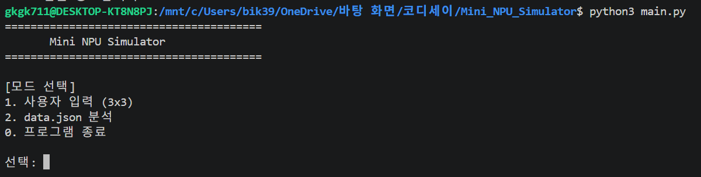

### 11.2 필터 입력 및 저장 확인

3×3 필터 A(Cross)와 필터 B(X)를 입력하고 저장된 배열을 확인하였다.

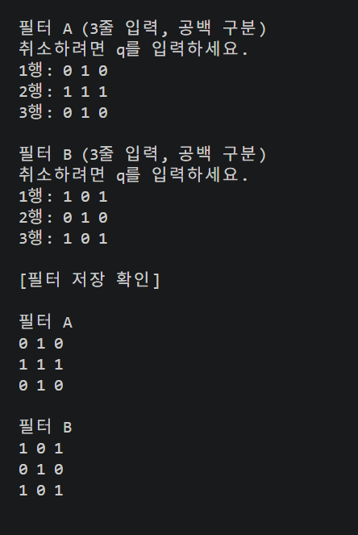

### 11.3 MAC 연산 및 판정 결과

X 패턴을 입력한 결과 A 점수는 1.0, B 점수는 5.0으로 계산되었으며 최종 판정은 B로 출력되었다.

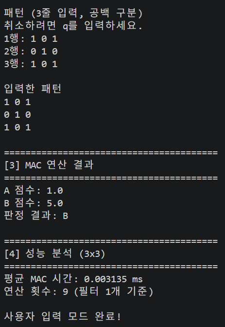

### 11.4 숫자 개수 오류 및 재입력

각 행에 필요한 숫자 개수가 부족할 때 오류 메시지가 출력되고 정상적인 재입력이 가능한지 확인하였다.

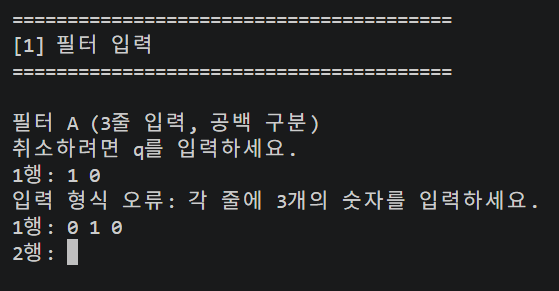

### 11.5 문자 입력 오류 및 재입력

숫자가 아닌 문자를 입력했을 때 오류 메시지가 출력되고 다시 입력받는 기능을 확인하였다.

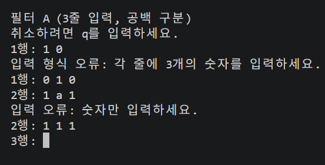

### 11.6 입력 취소 및 메뉴 복귀

사용자 입력 중 q를 입력하면 현재 작업을 취소하고 메인 메뉴로 돌아가는 기능을 확인하였다.

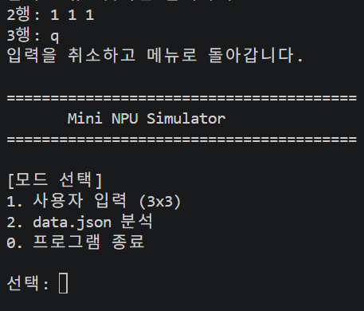

### 11.7 JSON 자동 분석 및 PASS/FAIL

data.json의 각 테스트 케이스에 대해 Cross/X MAC 점수를 계산하고 expected와 비교하는 기능을 확인하였다.

판정 결과는 PASS 또는 FAIL로 출력되며 실패 시 원인을 함께 기록한다.

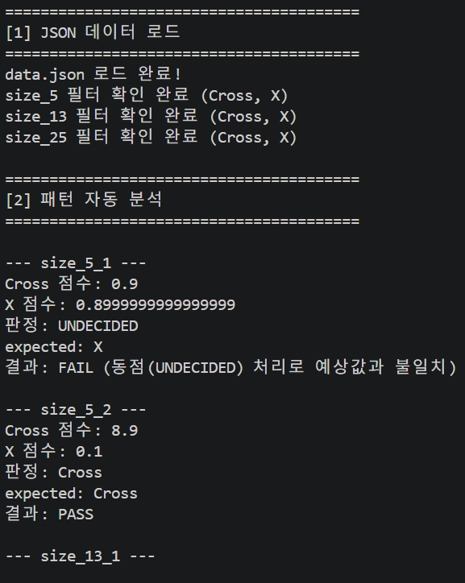

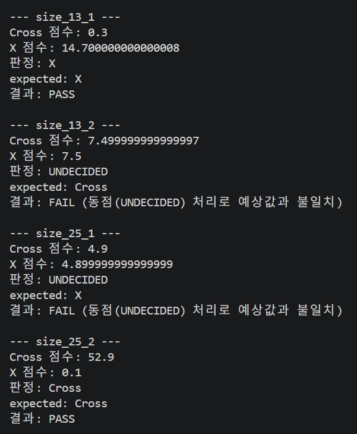

### 11.8 크기별 MAC 성능 분석

3×3, 5×5, 13×13, 25×25 패턴을 대상으로 각각 10회 반복 측정한 평균 MAC 연산 시간과 N² 연산 횟수를 확인하였다.

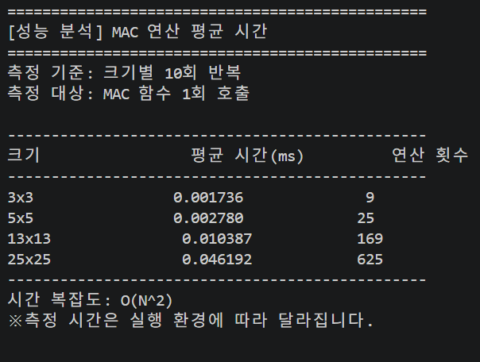

### 11.9 최종 결과 요약

JSON 분석 결과 전체 테스트 6개 중 3개가 PASS, 3개가 FAIL로 판정되었다.

실패한 케이스와 원인이 정상적으로 출력되는지 확인하였다.

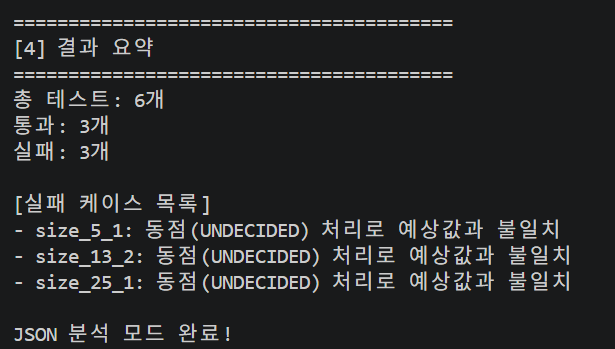

---

---

## 12. 보너스 과제 구현

### 12.1 보너스 과제 개요

이번 보너스 과제에서는 기존 Mini NPU Simulator의
MAC 연산 성능을 비교하고, Cross/X 패턴을 자동으로
생성하여 다른 실행 모드에서도 재사용할 수 있도록 구현하였다.

구현한 기능은 다음과 같다.

1. 2차원 배열을 1차원 배열로 변환
2. 2차원/1차원 MAC 연산 성능 비교
3. N×N Cross/X 패턴 자동 생성
4. 생성된 패턴을 모드 1에서 재사용
5. 생성된 패턴을 성능 분석에서 재사용

### 12.2 보너스 1 - MAC 연산 최적화

기존 MAC 연산은 2차원 리스트를 이용하여
matrix[i][j] 형태로 원소에 접근하였다.

보너스 과제에서는 2차원 리스트를 1차원 리스트로
변환한 뒤 flat[i] 형태로 접근하도록 구현하였다.

2차원 배열 예시:

    1 2 3
    4 5 6
    7 8 9

1차원 배열 예시:

    [1, 2, 3, 4, 5, 6, 7, 8, 9]

두 방식은 동일한 연산 결과를 반환하며,
시간 복잡도는 모두 O(N²)이다.

### 12.3 MAC 성능 비교 결과

동일한 5×5 Cross 패턴을 사용하여 2차원 MAC과
1차원 MAC 연산의 평균 실행 시간을 비교하였다.

측정 조건:
- 입력 크기: 5×5
- 입력 패턴: Cross
- 반복 횟수: 각 방식 1,000회
- 측정 단위: 밀리초(ms)
- 배열 변환 시간: 측정에서 제외

| 필터 | 2차원 MAC(ms) | 1차원 MAC(ms) | 점수 일치 |
|---|---:|---:|---|
| Cross | 0.006145 | 0.004057 | 일치 |
| X | 0.006505 | 0.002379 | 일치 |

이번 측정에서는 1차원 MAC 방식이 더 빠르게 나타났다.

다만 배열 변환에 필요한 시간은 제외하였으며,
실행 환경이나 측정 시점에 따라 결과가 달라질 수 있다.

### 12.4 보너스 2 - Cross/X 패턴 생성기

사용자로부터 패턴 크기 N을 입력받아
N×N Cross와 X 패턴을 생성하도록 구현하였다.

입력 조건:
- N은 3 이상 25 이하
- N은 홀수
- 문자 및 잘못된 범위 입력 시 재입력
- q 입력 시 취소

Cross 패턴은 가운데 행과 열을 1로 설정한다.

X 패턴은 두 대각선을 1로 설정한다.

예를 들어 N=5일 경우 다음 패턴이 생성된다.

Cross:

    0 0 1 0 0
    0 0 1 0 0
    1 1 1 1 1
    0 0 1 0 0
    0 0 1 0 0

X:

    1 0 0 0 1
    0 1 0 1 0
    0 0 1 0 0
    0 1 0 1 0
    1 0 0 0 1

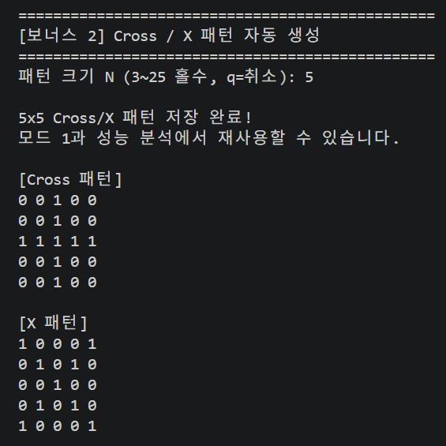

### 12.5 모드 1에서 생성 패턴 재사용

생성한 Cross/X 패턴을 딕셔너리에 저장하고,
모드 1에서도 불러올 수 있도록 구현하였다.

진행 과정:
1. 4번 메뉴에서 5×5 패턴 생성
2. 메인 메뉴로 복귀
3. 1번 사용자 입력 모드 선택
4. 저장된 Cross 패턴 불러오기
5. MAC 연산 및 판정 실행

검증 결과:
- Cross 점수: 9
- X 점수: 1
- 최종 판정: Cross
- 예상 정답: Cross
- 테스트 결과: PASS

생성된 패턴이 모드 1에서 정상적으로 재사용됨을 확인하였다.

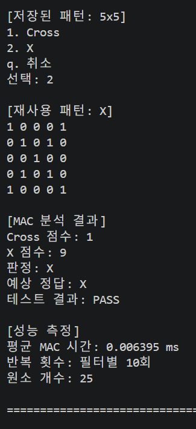

### 12.6 성능 분석에서 생성 패턴 재사용

보너스 2에서 생성한 패턴을 성능 분석 모드에서도
불러올 수 있도록 구현하였다.

저장된 패턴을 사용하여 2차원 MAC과
1차원 MAC 연산의 실행 시간을 비교하였다.

검증 과정:
1. 5×5 Cross 패턴 생성 및 저장
2. 3번 성능 분석 메뉴 선택
3. 저장된 패턴 재활용 선택
4. Cross 패턴 선택
5. 두 방식의 MAC 연산 시간 및 점수 비교

검증 결과:
- Cross 필터의 MAC 점수 일치
- X 필터의 MAC 점수 일치
- 두 방식 모두 O(N²) 시간 복잡도
- 2차원/1차원 MAC 실행 시간 비교 완료

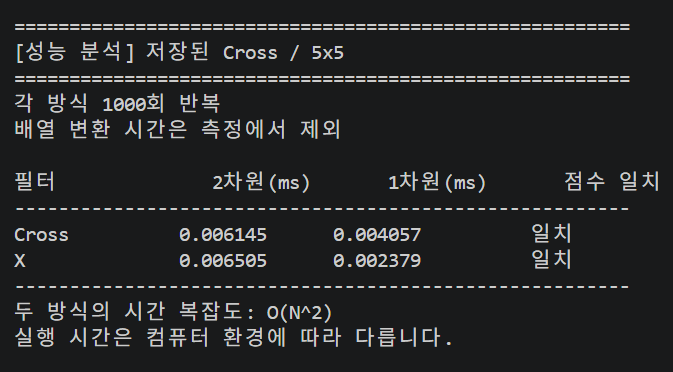

### 12.7 보너스 과제 학습 내용

이번 과제를 통해 다음 내용을 학습하였다.

1. 2차원 배열과 1차원 배열의 차이
2. 배열 접근 방식이 실행 시간에 미치는 영향
3. 동일 조건에서 성능을 비교하는 방법
4. Cross/X 패턴을 생성하는 알고리즘
5. 딕셔너리를 이용한 데이터 저장
6. 함수 간 데이터 전달 및 재사용
7. 여러 메뉴에서 동일한 데이터를 사용하는 프로그램 구조

특히 패턴 생성 기능을 독립적으로 구현하고,
생성된 패턴을 모드 1과 성능 분석에서
공통으로 사용할 수 있도록 구성하였다.

단, 생성된 패턴은 프로그램 실행 중에만 저장되며
프로그램 종료 후에는 유지되지 않는다.

---

## 13.

### 13.1 모드별 동점 처리 정책

Mini NPU Simulator는 Cross와 X 필터의 MAC 점수를
비교하여 최종 패턴을 판정한다.

두 점수의 차이가 EPSILON(1e-9)보다 작은 경우
동점으로 간주한다.

내부 판정값은 "UNDECIDED"로 통일한다.

다만 사용자 화면과 JSON 자동 분석의 목적이 다르므로
출력 표현을 구분한다.

| 구분 | 동점 처리 | 출력 표현 |
|---|---|---|
| 모드 1 직접 입력 | 동점 판정 | 판정 불가 |
| 모드 1 저장 패턴 재사용 | 동점 판정 | 판정 불가 |
| 모드 2 JSON 분석 | 동점 판정 | UNDECIDED |
| 보너스 성능 분석 | 판정값 대신 점수 일치 검증 | 일치/불일치 |

#### 동점 판정 한국어 출력 검증

평가 피드백을 반영하여 모드 1에서 두 MAC 점수가
동일할 경우 "UNDECIDED" 대신 "판정 불가"를
출력하도록 개선하였다.

내부 판정값은 "UNDECIDED"로 유지하고,
format_decision() 함수를 통해 사용자 출력 문구만
한국어로 변환하였다.

이를 통해 기존 JSON 자동 분석의 판정 로직을
변경하지 않으면서 사용자 출력 요구사항을 충족하였다.

**검증 조건**
- 실행 모드: 모드 1 (3×3 직접 입력)
- 필터 A: 모든 원소 0
- 필터 B: 모든 원소 0
- 입력 패턴: 모든 원소 0
- epsilon: 1e-9

**검증 결과**
- A MAC 점수: 0
- B MAC 점수: 0
- 내부 판정값: UNDECIDED
- 사용자 출력: 판정 불가
- 검증 결과: 정상

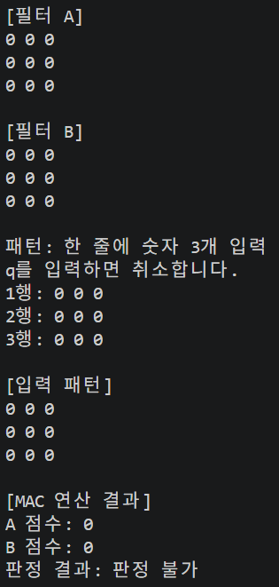

#### 모드 1에서 한국어를 사용하는 이유

모드 1은 사용자가 직접 입력하고 결과를 확인하는
대화형 기능이다.

따라서 사용자가 쉽게 이해할 수 있도록
"UNDECIDED"를 "판정 불가"로 표시한다.

#### 모드 2에서 UNDECIDED를 유지하는 이유

모드 2는 JSON의 expected 값과 프로그램의 판정값을
비교하는 자동 분석 기능이다.

내부적으로 "UNDECIDED"를 유지하면 판정 결과와
표시 문구를 구분할 수 있다.

현재 JSON 데이터에는 expected 값으로
Cross와 X가 사용된다.

따라서 동점 판정인 UNDECIDED는 expected와
일치하지 않아 FAIL로 기록될 수 있다.

이는 프로그램 실행 오류가 아니라
예상 정답과 실제 판정 결과의 불일치이다.

---

### 13.2 새로운 패턴 라벨 확장 절차

현재 프로그램은 Cross와 X 패턴을 지원한다.

추후 새로운 패턴 라벨을 추가하려면
단순히 문자열만 추가하는 것으로는 충분하지 않다.

정규화, 필터 검증, 점수 계산, 최종 판정,
출력, 테스트를 함께 수정해야 한다.

#### 1단계. 라벨 정규화

normalize_label()에 새로운 라벨의
표준 이름과 허용 별칭을 정의한다.

예를 들어 Circle 패턴을 추가한다면
"circle"을 "Circle"로 변환하도록 수정한다.

#### 2단계. 필터 데이터 추가

data.json의 해당 크기별 filters에
Circle 필터 행렬을 추가한다.

기존 Cross/X와 동일하게 N×N 크기인지 확인한다.

#### 3단계. 필터링 및 검증 확장

get_filters()에서 Circle 필터도 읽고 검증하도록 수정한다.

필터 이름의 중복 여부와
필터 행렬의 크기 및 값의 유효성도 확인한다.

#### 4단계. 점수 계산 및 최종 판정 확장

현재 classify()는 두 점수를 비교하는 구조이다.

패턴 종류가 3개 이상으로 확장된다면
모든 필터의 MAC 점수를 계산하고
가장 높은 점수를 선택하는 방식으로 변경한다.

가장 높은 두 점수의 차이가 EPSILON보다 작다면
동점으로 처리하는 정책을 적용한다.

#### 5단계. 출력 및 메뉴 확장

새 패턴의 이름과 점수가 사용자 화면과
JSON 자동 분석 결과에 표시되도록 수정한다.

패턴 자동 생성 기능까지 제공하려면
새 패턴 생성 함수도 구현한다.

#### 6단계. 테스트 케이스 추가

다음 항목을 검증한다.

- 새 라벨의 정상 정규화
- 대문자 및 소문자 입력
- 잘못된 라벨 입력
- 새 필터의 크기 검증
- 새 패턴의 정상 MAC 판정
- 기존 Cross/X 판정 유지
- 동점 발생 시 판정 불가 처리
- JSON의 PASS/FAIL 검증

이 과정을 통해 기존 기능에 영향을 최소화하면서
새로운 패턴 종류를 확장할 수 있다.

---

### 13.3 대규모 입력(1000×1000) 처리 설계

현재 Mini NPU Simulator의 패턴 생성기는
3~25 범위의 홀수 크기를 지원한다.

1000×1000 크기는 현재 구현의 지원 범위가 아니며,
이 절에서는 향후 대규모 입력을 지원하기 위한
확장 설계를 제안한다.

#### 1. 예상되는 주요 병목

1000×1000 배열에는 1,000,000개의 원소가 존재한다.

MAC 연산은 모든 원소를 확인하므로
필터 1개당 약 1,000,000번의 원소별
곱셈 및 누적 연산이 필요하다.

현재 Python 구현에서 예상되는 주요 병목은 다음과 같다.

1. Python 이중 반복문의 실행 비용
2. 리스트 인덱싱 및 객체 접근 비용
3. 대규모 배열을 생성하고 저장하는 메모리 비용
4. 2차원 배열을 1차원으로 변환하는 추가 비용
5. 전체 배열을 콘솔에 출력할 때 발생하는 출력 지연
6. 여러 번 성능을 측정할 때 증가하는 전체 실행 시간

MAC 연산의 시간 복잡도는 O(N²)이다.

따라서 입력 크기가 커질수록 연산량이
제곱에 비례하여 증가한다.

#### 2. 첫 번째 최적화: 메모리 레이아웃 개선

2차원 리스트를 1차원 리스트로 변환하면
중첩 리스트 구조를 단순화할 수 있다.

기존 접근 방식:

    matrix[i][j]

변환 후 접근 방식:

    flat[k]

다만 Python의 일반 리스트는 숫자 자체가 아닌
객체 참조를 저장하므로,
1차원 리스트로 변환한다고 항상 메모리 사용량이나
실행 시간이 크게 줄어드는 것은 아니다.

또한 기존 배열과 변환한 배열을 동시에 보관하면
메모리 사용량이 증가할 수 있다.

따라서 대규모 입력에서는 불필요한 배열 복사와
중간 데이터 생성을 최소화해야 한다.

#### 3. 두 번째 최적화: 불필요한 출력 제한

1000×1000 배열을 콘솔에 모두 출력하면
1,000개의 행과 1,000,000개의 값이 표시된다.

이는 터미널 출력과 사용자 확인 과정에
큰 부담을 줄 수 있다.

따라서 대규모 입력에서는 다음 정보만 출력한다.

- 배열 크기
- 패턴 종류
- MAC 점수
- 최종 판정
- 평균 실행 시간
- 일부 샘플 행

전체 행렬 출력은 디버깅이 필요한 경우에만 제공한다.

#### 4. 세 번째 최적화: 패턴의 희소성 활용

Cross와 X 패턴은 대부분의 원소가 0이다.

N이 홀수일 때 Cross와 X의
1인 원소 개수는 각각 2N-1개이다.

따라서 1000×1000처럼 큰 배열에서
모든 원소를 저장하고 계산하는 방식 대신,
0이 아닌 원소의 위치만 저장하는
희소 표현(Sparse Representation)을 고려할 수 있다.

필터가 희소하고 연산 구조가 이를 활용하도록
변경된다면 불필요한 곱셈을 줄일 수 있다.

단, 실제 개선 효과는 입력 데이터와
필터의 구조에 따라 달라진다.

#### 5. 네 번째 최적화: 실행 시간 측정 개선

기존 과제에서는 작은 크기의 MAC 연산을
반복 실행하여 평균 시간을 계산하였다.

대규모 입력에서도 1,000회를 무조건 반복하면
전체 측정 시간이 지나치게 길어질 수 있다.

따라서 다음 방식으로 측정을 개선할 수 있다.

1. 배열 크기에 따라 반복 횟수를 조절한다.
2. 측정 전에 함수를 미리 실행한다.
3. 동일한 입력 데이터로 두 방식을 비교한다.
4. 여러 차례 측정해 대표값을 비교한다.
5. 배열 생성 및 변환 시간을 별도로 기록한다.

단, 두 방식의 공정한 성능 비교를 위해
같은 크기에서는 동일한 입력과 반복 횟수를 사용한다.

#### 6. 다중 스레드와 병렬 처리 검토

MAC 연산을 여러 작업으로 나누는
병렬 처리도 확장 방안 중 하나이다.

하지만 일반적인 CPython 환경에서는
GIL의 영향으로 CPU 중심의 Python 코드가
여러 스레드에서 실행된다고 해서
자동으로 빨라지지는 않는다.

대안으로 multiprocessing을 사용할 수 있지만
프로세스 생성 및 데이터 전달 비용이 발생한다.

따라서 작은 입력에서는 병렬 처리보다
단일 프로세스 실행이 효율적일 수 있다.

대규모 계산에서 병렬 처리를 적용한다면
데이터 분할 비용, 메모리 복사 비용,
작업 합산 비용까지 함께 측정해야 한다.

외부 라이브러리 사용이 허용되는 환경이라면
NumPy 같은 배열 연산 라이브러리도
추가 최적화 방안으로 검토할 수 있다.

이는 현재 외부 라이브러리 없이 작성된
과제 구현과는 별도의 확장 방향이다.

#### 7. 최적화 우선순위

대규모 입력을 지원한다면
다음 순서로 개선하는 것이 적절하다고 판단하였다.

1순위: 전체 행렬 출력 제한
2순위: 불필요한 배열 복사 및 메모리 사용 최소화
3순위: 희소 패턴을 활용한 연산량 감소
4순위: 반복 횟수와 측정 방법 개선
5순위: 병렬 처리 또는 외부 배열 연산 라이브러리 검토

최적화에서는 단순히 실행 시간이 짧아지는 것뿐만
아니라 MAC 점수의 정확성이 유지되는지도 중요하다.

따라서 최적화 전후의 연산 결과를
동일한 입력으로 검증해야 한다.

---

### 13.4 평가 피드백 보완 요약

| 평가 항목 | 보완 내용 |
|---|---|
| #2 | 모드 1의 UNDECIDED를 판정 불가로 표시 |
| #17 | 모드 1과 모드 2의 동점 처리 정책 명시 |
| #18 | 새 라벨 추가 시 수정할 기능과 테스트 절차 작성 |
| #19 | 1000×1000 입력 시 병목과 최적화 우선순위 설명 |

본 보완을 통해 기존 기능의 정확성을 유지하면서
사용자 출력 정책과 향후 확장 설계 근거를
명확하게 문서화하였다.

## 14. 최종 제출 결과

본 프로젝트는 Python으로 MAC 연산을 직접 구현하고, 사용자 입력 및 JSON 자동 분석을 통해 Cross/X 패턴을 판별하는 Mini NPU 시뮬레이터이다.

입력 검증, 라벨 정규화, epsilon 기반 동점 처리, PASS/FAIL 결과 요약, 크기별 성능 분석 및 시간 복잡도 보고서를 작성하였다.

최종적으로 main.py, data.json, README.md와 기능 검증 스크린샷 10장을 제출 자료로 구성하였다.

본 프로젝트의 핵심 목표인 MAC 연산 구현, 패턴 판정, 데이터 검증, 성능 측정 및 실패 원인 분석을 수행하였다.
